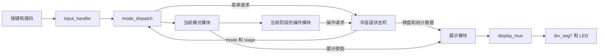

# 华容道电路架构

## 1. 电路核心状态与概念

### 1. 局面

局面用一个 `logic[3:0] layout[8:0]` 表示.
其中 `layout[i]` 是一个 `logic[3:0]` 的变量,
是一个 BCD 码, 表示第 i 个位置的方块编号.
下标 0..8 按照从左往右, 从上到下的次序对应 9 个格子, 0 号棋子表示空位.

### 2. 模式

模式用一个 `enum logic [1:0]` 类型的变量 `mode` 表示.
这一变量决定了哪些电路会被激活, 输入信号如何处理, 以及输出如何显示.

1. `GM_GAME` 表示游戏模式, 用户可以输入棋子编号, 初始化局面或移动棋子.
2. `GM_MENU` 表示菜单模式, 用户可以选择游戏模式, 或是查看最近一次游戏或所有游戏的统计信息.
3. `GM_DEMO` 表示演示模式, 用户按演示切换键推进演示.
4. `GM_STAT` 表示统计模式, 显示 `stat_stage` 对应的统计信息.

复位时 `mode` 为 `GM_GAME`. 通过模式选择切换到 `GM_GAME`, `GM_MENU` 或 `GM_DEMO` 时, 初始化局面和阶段.
从通关阶段进入 `GM_STAT` 时, 统计模式使用当前的终局和步数.

### 3. 游戏阶段

游戏阶段用一个 `enum logic [1:0]` 类型的变量 `game_stage` 表示.
复位或进入游戏模式时, `game_stage` 为 `GAME_STAGE_INIT`.

1. `GAME_STAGE_INIT` 表示初始化阶段, 等待用户输入当前格子的棋子编号.
    前 8 个格子每写入一个合法编号, 就进入下一个格子.
    第 9 个编号合法时, 在同一个 `clk` 上升沿写入编号并切换阶段.
    局面判断模块对填入第 9 个编号后的局面输出 `is_win`. `is_win` 为 1 时进入 `GAME_STAGE_WIN`, 否则进入 `GAME_STAGE_PLAY`.
    本次输入非法时, 用户只有重新输入正确的棋子编号才能继续后续的初始化操作.
2. `GAME_STAGE_PLAY` 表示游戏进行阶段, 等待用户输入要移动的棋子编号.
    用户确认移动后, 如果移动合法且局面判断模块对下一局面输出的 `is_win` 为 1, 则进入 `GAME_STAGE_WIN`.
    其他移动继续停在 `GAME_STAGE_PLAY`.
3. `GAME_STAGE_WIN` 表示游戏通关阶段, 显示通关局面.
    再按一次确认键后, 将 `mode` 设为 `GM_STAT`, 将 `stat_stage` 设为 `STAT_STAGE_LATEST`.

### 4. 演示阶段

演示阶段用一个 `enum logic [1:0]` 类型的变量 `demo_stage` 表示.
复位或进入演示模式时, `demo_stage` 为 `DEMO_STAGE_WAIT`.
每按一次演示切换键, 执行一次当前阶段对应的操作.

1. `DEMO_STAGE_WAIT` 表示等待演示. 按键后写入初始局面 `123456708`, 进入 `DEMO_STAGE_INIT`.
2. `DEMO_STAGE_INIT` 展示初始化后的局面. 按键后尝试移动 1 号棋子, 进入 `DEMO_STAGE_PLAY`.
3. `DEMO_STAGE_PLAY` 展示上一步操作后的局面. 按键后尝试移动 8 号棋子,
    移动合法且局面判断模块对下一局面输出的 `is_win` 为 1 时进入 `DEMO_STAGE_WIN`, 否则停在当前阶段.
4. `DEMO_STAGE_WIN` 展示通关局面.
    再按一次演示切换键后, 将 `mode` 设为 `GM_STAT`, 将 `stat_stage` 设为 `STAT_STAGE_LATEST`.

### 5. 错误标志

错误标志用一个 `enum logic` 类型的变量 `input_error` 表示.
`INPUT_OK` 为 0, 表示当前没有错误.
`INPUT_INVALID` 为 1, 表示本次初始化输入或移动操作非法.

收到非法输入时, 将 `input_error` 设为 `INPUT_INVALID`.
收到合法输入时, 将 `input_error` 设为 `INPUT_OK`.
复位, 切换模式或演示回到等待阶段时, 也将错误标志设为 `INPUT_OK`.
游戏和演示中的走棋使用同一套合法性判定.

## 华容道部分

### 1. 局面计算模块

这是一个纯组合逻辑电路模块, 用于计算下一局面状态.

输入为当前局面状态 `logic[3:0] cur_layout[8:0]` 和要移动的棋子编号 `logic[3:0] move_piece`.
输出为下一局面状态 `logic[3:0] nxt_layout[8:0]` 和操作合法性 `logic valid`.

在完整局面中, 编号为 1..8 且位于 0 号棋子上下左右的棋子才可以移动.
如果操作合法, 则 `valid` 为 1, `nxt_layout` 中交换这两个棋子.
如果操作非法, 则 `valid` 为 0, `nxt_layout` 等于 `cur_layout`.

### 2. 局面提示模块

这是一个纯组合逻辑电路模块, 用于判断有哪些棋子是可以移动的.

输入为当前局面状态 `logic[3:0] cur_layout[8:0]` 和局面是否完整 `logic layout_ready`.
输出为 `logic[8:0] movable`, `movable[i]` 表示 i 号棋子是否可以移动, 1 表示可以移动, 0 表示不可以移动.
`movable[0]` 始终为 0. 如果局面还未填满, 则 `movable` 的所有位均为 0.

### 3. 局面判断模块

这是一个纯组合逻辑电路模块, 用于判断给定的局面是否为胜利局面.

输入为待判断的局面 `logic[3:0] judge_layout[8:0]` 和该局面是否完整 `logic judge_ready`.
输出为 `logic is_win`. `judge_ready` 为 1 且按下标 0..8 读取的编号依次为 `123456780` 时,
`is_win` 为 1, 否则为 0.

### 4. 华容道状态机

这是一个状态机, 负责华容道游戏的整体控制逻辑.
局面 `layout`, 已填格数 `init_count`, 已用编号 `used_piece`, 步数和上述模式, 阶段, 错误标志都保存在这个模块中.
`used_piece[i]` 为 1 表示 i 号棋子已经输入.
来源模式用一个和 `mode` 类型相同的变量 `stat_source_mode` 表示.
进入统计模式时, 将切换前的 `mode` 记录到 `stat_source_mode`.

输入为时钟 `logic clk`, 低有效复位信号 `logic rst_n`, 模式选择 `logic[1:0] mode_sel`,
单周期模式选择信号 `logic mode_sel_en`, 菜单选择的统计阶段 `logic stat_all_sel`,
经分发的棋子编号 `logic[3:0] piece_in`, 单周期确认信号 `logic confirm_pos`, 单周期撤回信号 `logic undo_req`,
单周期演示切换信号 `logic demo_next`,
下一局面状态 `logic[3:0] nxt_layout[8:0]`, 操作合法性 `logic valid` 和胜利标志 `logic is_win`.
在 `mode_sel_en` 为 1 时读取 `mode_sel`. 值为 0, 1, 2 时分别选择 `GM_GAME`, `GM_MENU`, `GM_DEMO`.
菜单中选择 `mode_sel` 为 3 时进入 `GM_STAT`. `stat_all_sel` 为 0 时进入 `STAT_STAGE_LATEST`, 为 1 时进入 `STAT_STAGE_ALL`.

输出为当前局面状态 `logic[3:0] layout[8:0]`, 已填格数 `logic[3:0] init_count`,
局面是否完整 `logic layout_ready`, 送到局面计算模块的棋子编号 `logic[3:0] move_piece`,
送到局面判断模块的局面 `logic[3:0] judge_layout[8:0]` 和完整标志 `logic judge_ready`, 以及错误标志 `logic input_error`.
显示部分读取 `mode` 和各阶段的编码.
`init_count` 为 9 时, `layout_ready` 为 1, 否则为 0.
游戏模式下 `move_piece` 取 `piece_in`. 演示模式下, 在 `DEMO_STAGE_INIT` 取 1, 在 `DEMO_STAGE_PLAY` 取 8.
其他情况下 `move_piece` 为 0.

`judge_layout` 和 `judge_ready` 由状态机用组合逻辑给出.
确认输入的第 9 个编号合法时, `judge_layout` 取填入该编号后的局面, `judge_ready` 为 1.
游戏中按确认键或演示中按演示切换键提交合法移动时, `judge_layout` 取 `nxt_layout`, `judge_ready` 为 1.
其他情况下, `judge_layout` 取 `layout`, `judge_ready` 取 `layout_ready`.
这样写入最后一个编号或提交合法移动时, 就可以在写入局面的同一个 `clk` 上升沿根据 `is_win` 切换阶段.

棋盘在以下情况下写入.

1. 复位时清空 `layout`, `init_count` 和 `used_piece`.
    通过模式选择切换到游戏, 菜单或演示模式时, 以及演示从统计模式回到 `DEMO_STAGE_WAIT` 时, 也清空这些变量.
2. 在游戏模式的 `GAME_STAGE_INIT` 阶段, 收到 `confirm_pos` 时检查 `piece_in`.
    编号在 0..8 内且对应的 `used_piece` 位为 0 时, 将编号写入 `layout[init_count]`,
    将 `used_piece` 的对应位设为 1, 并将 `init_count` 加 1.
    编号非法时, 只设置错误标志, 等待重新输入当前格子.
3. 在游戏模式的 `GAME_STAGE_PLAY` 阶段, 收到 `confirm_pos` 且 `valid` 为 1 时,
    将 `nxt_layout` 写入 `layout`. 在演示的两次走棋中, 用 `demo_next` 触发同样的判定和写入.
    移动非法时, 只设置错误标志和更新无效步数.
4. 在演示模式的 `DEMO_STAGE_WAIT` 阶段, 收到 `demo_next` 时写入演示初始局面,
    将 `init_count` 设为 9, 将 `used_piece` 的各位设为 1.
5. 在游戏模式的 `GAME_STAGE_PLAY` 阶段, 收到 `undo_req` 且有可撤回记录时, 恢复记录中的局面和步数.

确认, 撤回和演示切换操作均在 `clk` 上升沿处理. 复位和模式切换优先于这些操作. 遇到非法的模式或阶段编码时, 回到复位后的状态.

### 5. (扩展) 操作编译模块

这是一个纯组合逻辑电路模块, 用于将用户输入的操作转换为选择的棋子编号.

输入: 用户输入的操作 `logic[3:0] user_input`, `user_input[0/1/2/3]` 分别表示上/下/左/右移动, 当前局面状态 `logic[3:0] cur_layout[8:0]`
输出: 要移动的棋子编号 `logic[3:0] move_piece`, 如果用户输入的操作不合法, 则输出 `move_piece` 为 0xF.

## 菜单部分

菜单是一个单页, 用 `logic[1:0] menu_sel` 表示选中的条目.
在其他模式下收到菜单事件时, 进入 `GM_MENU`, 清空局面和本局的统计信息. 当前未完成的一局到此结束.

在菜单中, 用户用两位拨码选择条目. 数码管显示对应的编号, 按确认键后执行该条目.

| `menu_sel` | 显示编号 | 条目 | 确认后的模式和阶段 |
| --- | --- | --- | --- |
| `2'b00` | 1 | 开始游戏 | `GM_GAME`, `GAME_STAGE_INIT` |
| `2'b01` | 2 | 开始演示 | `GM_DEMO`, `DEMO_STAGE_WAIT` |
| `2'b10` | 3 | 查看最近一局 | `GM_STAT`, `STAT_STAGE_LATEST` |
| `2'b11` | 4 | 查看累计统计 | `GM_STAT`, `STAT_STAGE_ALL` |

菜单模块收到确认事件后, 发出一次 `mode_sel_en`, 并设置对应的 `mode_sel` 和 `stat_all_sel`.
进入统计后可以按菜单键回到菜单.

## 统计部分

统计阶段用一个 `enum logic` 类型的变量 `stat_stage` 表示.
复位时 `stat_stage` 为 `STAT_STAGE_LATEST`.

1. `STAT_STAGE_LATEST` 显示最近一局的有效步数和无效步数.
    从游戏或演示的通关阶段进入统计模式时, 进入这一阶段, 显示刚结束的一局的统计信息.
    从菜单选择查看最近一局时, 读取最近一局已通关的正式游戏的统计信息.
2. `STAT_STAGE_ALL` 显示所有已通关正式游戏的累计有效步数和累计无效步数.
    从菜单选择查看累计统计时进入这一阶段.

正式游戏进入 `GAME_STAGE_WIN` 时, 用更新后的步数保存最近一局的统计, 并累加到累计统计中.
演示使用本局的步数进入统计模式. 全局复位时清零本局和历史统计.

在统计模式下, 如果是从演示进入的 `STAT_STAGE_LATEST`, 再按一次演示切换键回到 `GM_DEMO` 的 `DEMO_STAGE_WAIT`,
并清空局面和本局的统计信息. 其他情况下, 由复位或模式选择退出统计模式.

## 顶层模块

顶层模块为 `main`, 负责连接板上输入, 模式分发, 华容道状态机, 展示模块和板级驱动.

### 模式和阶段分发

`mode_dispatch` 根据当前寄存的 `mode`, 只使能对应的 `game_mode`, `menu_mode`, `demo_mode` 或 `stat_mode`.
游戏, 演示和统计模块再根据各自的 `*_stage`, 使能当前阶段需要的操作模块和展示模块.
菜单模块直接处理条目选择和确认.

操作模块接收本阶段的输入, 向华容道状态机发出操作或模式切换请求.
`mode`, 各阶段, 局面和步数由华容道状态机统一更新.
游戏和演示共用局面计算模块和局面判断模块.

各模块共用同一个 `clk`. 时序模块在 `en` 为 1 时处理输入和更新状态.
未使能模块的输入事件和对应数据均置零.

## 输出展示部分

各展示模块在使能时接收所需数据, 产生对应的显示信号.
`display_mux` 按输出组选择信号. 同一组输出在同一时刻只选一个模块, 不同组可以同时显示.

| 输出组 | 展示模块 | 选择条件 |
| --- | --- | --- |
| 8 位数码管 | `board_view`, `menu_view`, `stat_view` | 游戏和演示显示棋盘, 菜单显示条目编号, 统计模式显示当前统计阶段 |
| 第 9 格 LED | `board_view` | 棋盘展示使能时显示第 9 格的编码, 其他情况下全灭 |
| 提示和统计共用 LED | `hint_view`, `count_view` | 游戏和演示按展示选择显示一路, 通关后的统计页显示步数 |
| 模式和状态 LED | `status_view` | 根据 `mode`, 通关状态和 `input_error` 输出 |

`board_view` 负责空格和非法初始化的显示. 0 号棋子在数码管上显示为空白, 在第 9 格显示为全灭.
非法初始化时, 当前格子显示 `E`, 第 9 格的非法输入显示为四灯全亮.
`hint_view` 根据 `movable[8:1]` 显示可移动棋子, LED 从左到右对应 1 到 8 号棋子.

游戏和演示的展示选择从统计开始, 第一次按展示切换键时显示提示, 此后每次按键切换一路.
通关阶段继续显示终局, `status_view` 点亮通关灯. 非法输入时, 状态灯闪烁.
从通关阶段进入统计模式时, `stat_view` 和 `count_view` 使用同一组显示步数,
分别输出十进制数码管段码和二进制 LED 编码. 数码管左侧两位显示有效步数, 右侧两位显示无效步数.

没有展示模块被选中的输出组取空白或全灭. 演示回到 `DEMO_STAGE_WAIT` 时, 所有展示输出均为空白或全灭.
数码管段码统一送到 [drv_seg7](src/modules/driver/drv_seg7.sv) 扫描.

## 输入处理部分

`input_handler` 对按键和拨码输入先同步, 再消抖. 按键可用 [pulse_debounce](lib/baselib/clock/pulse_debounce.sv) 的 `rise` 输出产生单周期事件.
处理后的按键事件包括确认 `confirm_pos`, 撤回 `undo_req`, 展示切换 `display_toggle`, 演示切换 `demo_next` 和菜单 `menu_req`.

拨码按整组判断是否稳定. 游戏用其中四位表示棋子编号 `piece_in`, 菜单用其中两位表示条目 `menu_sel`.
需要拨码数据的阶段只在收到确认且对应拨码值稳定时提交操作. 通关后的确认直接提交统计模式切换请求.

`mode_dispatch` 根据当前模式分发输入, 被使能的模式模块再根据当前阶段转发.

| 模式和阶段 | 接收的操作 |
| --- | --- |
| `GM_MENU` | 选择条目并确认 |
| `GAME_STAGE_INIT` | 确认棋子编号 |
| `GAME_STAGE_PLAY` | 确认棋子编号或撤回 |
| `GAME_STAGE_WIN` | 确认进入统计模式 |
| `GM_DEMO` 的各阶段 | 演示切换 |
| 从演示进入的 `STAT_STAGE_LATEST` | 演示切换, 返回等待演示 |

游戏和演示的展示选择逻辑接收 `display_toggle`.
复位由上层处理. 在其他模式收到 `menu_req` 时, `mode_dispatch` 发出 `mode_sel_en`, 令 `mode_sel` 为 1.
进入菜单的请求和确认同拍时, 只处理菜单请求.
按键事件只在当前模式和阶段处理一次, 切换后的模式和阶段从下一个时钟沿开始接收新事件.
